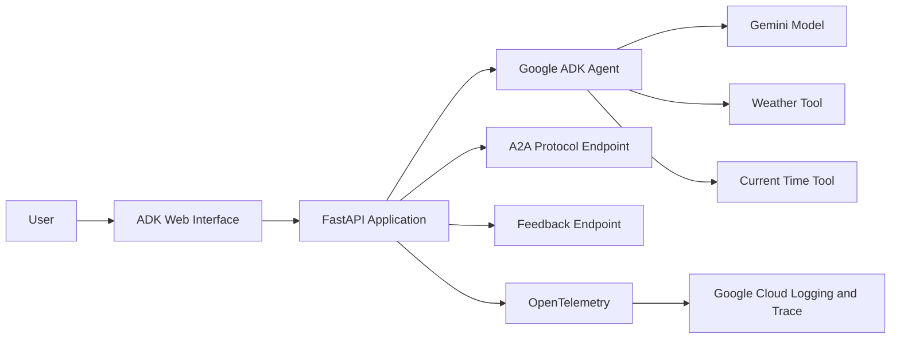

# Weather Assistant Agent

An AI-powered conversational assistant built with **Google Agent Development Kit (ADK)** and **Gemini**. The project provides a foundation for answering weather-related questions, retrieving city-specific time information, and exposing the agent through a FastAPI application and the Agent2Agent (A2A) protocol.

> **Current implementation note:** This is an initial prototype. Weather responses are simulated using hardcoded values, not retrieved from a live weather API. Time lookup currently supports San Francisco only.

## Architecture

The application uses Google ADK to manage the agent and its tools. FastAPI exposes the application through HTTP endpoints, while the A2A integration allows compatible clients to communicate with the agent.



## Features

- **Conversational AI:** Uses Gemini through Google ADK to process user messages.
- **Weather tool:** Returns simulated weather information based on the requested location.
- **Current time tool:** Retrieves the current local time for San Francisco using Python's `zoneinfo`.
- **Web interface:** Provides an ADK web interface for interacting with the agent.
- **FastAPI backend:** Serves the agent through an API application.
- **A2A protocol support:** Exposes agent-card and JSON-RPC endpoints for agent interoperability.
- **Feedback endpoint:** Accepts user feedback and logs it through Google Cloud Logging.
- **Observability:** Integrates OpenTelemetry with Google Cloud Trace and Cloud Logging.

## Technology Stack

| Technology | Purpose |
|---|---|
| Python | Main programming language |
| Google ADK | Agent development and orchestration |
| Gemini | Large language model |
| FastAPI | Backend API |
| A2A SDK | Agent-to-agent communication |
| uv | Python dependency and environment management |
| Docker | Containerization |
| OpenTelemetry | Application instrumentation |
| Google Cloud | Logging and tracing integrations |
| Pytest | Testing |

## How It Works

1. A user submits a message through the ADK web interface or a compatible API client.
2. The FastAPI application passes the request to the Google ADK agent.
3. Gemini interprets the user's request and determines whether a tool is needed.
4. The agent can invoke one of its available tools:
   - `get_weather(query)` returns a simulated weather response.
   - `get_current_time(query)` returns the current San Francisco time when the query identifies that location.
5. The agent generates a response and returns it to the user.

## Project Structure

```text
weather-assistant/
│
├── app/
│   ├── agent.py
│   ├── fast_api_app.py
│   │
│   └── app_utils/
│       ├── a2a.py
│       ├── services.py
│       ├── telemetry.py
│       └── typing.py
│
├── tests/
│   ├── eval/
│   │   ├── datasets/
│   │   ├── eval_config.yaml
│   │   └── metrics.py
│   │
│   ├── integration/
│   └── unit/
│
├── .env.example
├── agents-cli-manifest.yaml
├── Dockerfile
├── GEMINI.md
├── pyproject.toml
├── README.md
└── uv.lock
```

## Prerequisites

Before running the project, install:

- **Python:** 3.11–3.13
- **uv:** Python package and environment manager. [Installation guide](https://docs.astral.sh/uv/getting-started/installation/)
- **Google Agents CLI:** Agent project management and development tools.
- **Google Cloud SDK:** Required for Google Cloud authentication and Vertex AI usage.
- **Google Cloud project:** Required for the Vertex AI configuration.

## Getting Started

### 1. Clone the repository

```bash
git clone <your-repository-url>
cd weather-assistant
```

### 2. Install Google Agents CLI

```bash
uv tool install google-agents-cli
```

### 3. Set up the project

```bash
uvx google-agents-cli setup
```

### 4. Install dependencies

```bash
agents-cli install
```

### 5. Configure environment variables

Create a `.env` file using the example configuration:

```bash
cp .env.example .env
```

For Windows PowerShell:

```powershell
Copy-Item .env.example .env
```

Configure your Google Cloud project:

```env
GOOGLE_GENAI_USE_VERTEXAI=true
GOOGLE_CLOUD_PROJECT=your-gcp-project-id
GOOGLE_CLOUD_LOCATION=global
```

Alternatively, configure Gemini through Google AI Studio by using a Gemini API key:

```env
GEMINI_API_KEY=your-api-key-here
```

Use the authentication method appropriate to your configuration. Do not commit your `.env` file or API keys to GitHub.

### 6. Authenticate with Google Cloud

For Vertex AI usage, configure Application Default Credentials:

```bash
gcloud auth application-default login
```

Set your active project:

```bash
gcloud config set project <your-project-id>
```

The current FastAPI startup code also initializes Google Cloud authentication and Cloud Logging, so verify that its Google Cloud credentials and project configuration are available when running the server.

### 7. Run the agent locally

Start the interactive development environment:

```bash
agents-cli playground
```

The playground provides a local interface for testing the agent.

## Available Commands

| Command | Description |
|---|---|
| `agents-cli install` | Install project dependencies |
| `agents-cli playground` | Start the local agent playground |
| `agents-cli lint` | Run code quality checks |
| `agents-cli eval generate` | Generate agent evaluation traces |
| `agents-cli eval grade` | Grade agent responses |
| `agents-cli eval compare` | Compare evaluation results |
| `agents-cli eval analyze` | Analyze agent failure patterns |
| `uv run pytest tests/unit tests/integration` | Run unit and integration tests |

## API and A2A Integration

The FastAPI application exposes the agent through the ADK API and adds A2A routes.

The main endpoints include:

| Endpoint | Purpose |
|---|---|
| `/run_sse` | ADK streaming interaction endpoint |
| `/feedback` | Submit user feedback |
| `/a2a/app/` | A2A JSON-RPC endpoint |
| `/a2a/app/.well-known/agent-card.json` | A2A agent card |

The A2A integration supports streaming and allows compatible agent clients to discover and communicate with this assistant.

## Testing

Run the unit and integration test suites:

```bash
uv run pytest tests/unit tests/integration
```

The project also includes an evaluation workflow for assessing response quality.

Generate evaluation traces:

```bash
agents-cli eval generate
```

Grade the generated traces:

```bash
agents-cli eval grade
```

Additional evaluation commands:

```bash
agents-cli eval compare
agents-cli eval analyze
agents-cli eval optimize
```

The evaluation configuration includes a custom response-quality metric using Gemini as an evaluator.

## Docker

The repository includes a Dockerfile based on Python 3.12 Slim. It installs `uv`, synchronizes the project dependencies, and starts the FastAPI application using Uvicorn.

Build the image:

```bash
docker build -t weather-assistant .
```

Run the container:

```bash
docker run --env-file .env -p 8080:8080 weather-assistant
```

The application listens on port `8080` inside the container.

## Future Improvements

- Integrate a real weather API to replace simulated weather responses.
- Support weather queries for multiple cities and countries.
- Add location-aware time-zone lookup for arbitrary cities.
- Improve error handling for invalid locations and unavailable API services.
- Add more unit tests for weather and time tools.
- Expand evaluation datasets to cover different weather queries and multi-turn conversations.
- Improve response quality through iterative prompt and evaluation testing.

## License

This project uses Google ADK and related dependencies. Refer to the respective project licenses and documentation for their terms.
